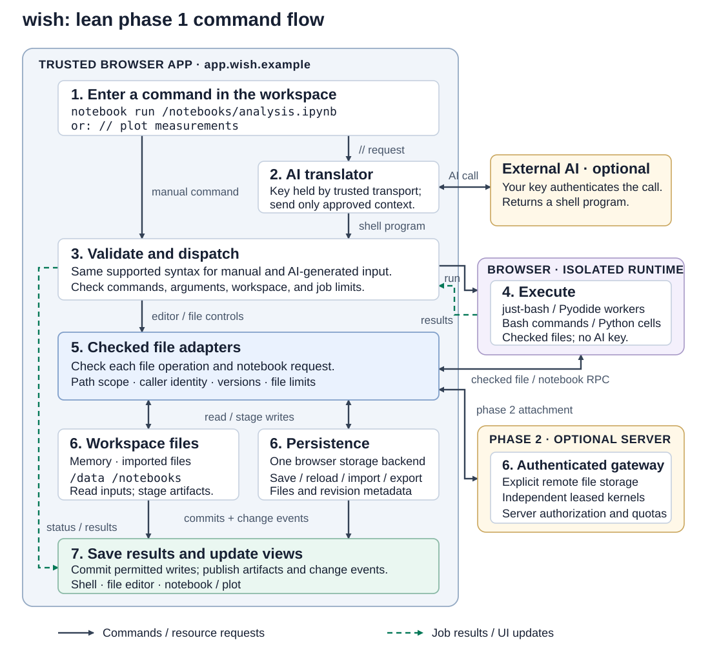

# wish: a browser command shell

wish is the web interactive shell.

Status: phased design proposal, 2026-10-14. Runtime commands are not implemented.
[PHASES.md](PHASES.md) defines the active lean phase 1 and conditional phase 2.
Phase 1 uses files, ordinary byte/text pipes, one notebook, and BYOK `//` translation;
the broader page, Wasm, server, and device ideas below belong to phase 2.

## Definition

A **browser command shell**, or **web shell**, is an interactive command environment
whose resources are workspace files, datasets, notebooks, live web pages, virtual
devices, compute sessions, browser tabs, and JavaScript and WebAssembly runtimes.
It gives these resources the familiar shell operations of selection, inspection,
execution, composition, and modification.

In wish, a page is a live executable workspace: its scripts, event handlers, rendering,
and WebAssembly applications keep running while the user issues commands. The user
can create and change files, add data and resources, build interactive tools,
invoke application functions, and run computations from the same prompt. DOM
commands are one interface to that workspace.

The shell accepts both explicit commands and natural-language requests prefixed
with `//`. Using the user's own AI API key, wish translates each request into actual
shell commands and executes them through the ordinary shell runtime.

## The browser as a place to work

The primary environment is a workspace owned by the user. Work can stay in browser
memory, persist in browser storage, use explicitly selected local files, or access
authenticated server storage and compute. The shell presents these as named mounts
and resources with visible location, persistence, and access rights. "Local" work
means working in this environment; it does not require every resource to live on
the physical computer or every computation to run on the server.

For example, wish can create a Python notebook, import measurements, execute cells
in a browser kernel, save results, and display a plot as a live tool. The same
notebook can explicitly acquire a remote compute session when its packages or data
exceed browser capabilities. Moving data or execution to a server is a visible
choice, not an automatic consequence of opening the notebook.

Virtual resources give programs scoped access to useful physical capabilities:
storage volumes, memory-backed files, worker compute, an available GPU, simulated
devices, or a leased server process. Each exposes a defined interface and limits.
An actual camera, serial device, or other user hardware needs the browser's own
permission flow and a dedicated adapter. Browser virtualization does not imply
unrestricted access to the host machine.

The phased scope is defined in [PHASES.md](PHASES.md), the technical model in
[ARCH.md](ARCH.md), trust boundaries in [SEC.md](SEC.md), and related tools in
[SOTA.md](SOTA.md). Phase 1 works with files and internal object IDs; the original
generic resource-handle model is an optional future design, not a prerequisite.

## Browser resources and shell state

| Shell concept | Browser equivalent |
| --- | --- |
| Current working context | Workspace, working directory, selected tool/page, and kernel |
| Addressable resources | File paths and simple notebook/job names; page/device IDs remain internal when those adapters are added |
| Executable | Built-in command, registered page function, JavaScript module, or Wasm command |
| Standard input/output | Ordinary byte/text streams; JSON and CSV files/text provide structured data |
| Process/job | Command pipeline, page task, or worker computation |
| Filesystem | Mounted memory, browser storage, selected local directories, or server storage |
| Data and devices | JSON/CSV files first; selected dataset, database, and device commands can follow |
| Environment/history | Session settings, selected context, commands, and results |

The selected page stays explicit; changing browser focus does not silently retarget
a running command. Handles belong to a particular document. Navigation or reload
invalidates its DOM handles and cancels work tied to that document. An explicit
navigation command may establish a new context after checking access to the target.

Workspace paths such as `/pages/counter/index.html` belong to wish's virtual
filesystem. Access to the user's actual files requires an explicit browser file
grant or import/export action. Commands run in browser runtimes or an explicitly
selected server session. A server process has access to its allocated resources;
access to processes on the user's computer would require a separate native adapter.

## Command language

Evaluate just-bash before implementing shell parsing and execution. Start with a
tested subset: commands with quoted arguments, newlines, pipes using `|`, output
redirection using `>`, and `#` comments. Validate supported syntax and command
arguments, and check permissions when operations run. Compose with bytes/text and
JSON/CSV; typed record pipelines and public resource handles are deferred.

Each job exposes output, diagnostics, and an exit status. Pipeline failures stop
dependent steps, and cancellation stops subsequent commands. Completed page or
network effects remain visible even if a later step fails; a pipeline is not an
atomic transaction. History preserves explicit commands so they can be inspected
and run again without an AI request.

Illustrative command vocabulary; the phase column is planned scope, not availability:

| Commands | Purpose | Phase |
| --- | --- | --- |
| `ls [PATH]`, `mkdir PATH`, `cp SOURCE DEST`, `cat PATH`, `printf '%s' TEXT > PATH` | Inspect, create, and change files using ordinary shell operations | 1 |
| `jq FILTER`, other selected text/CSV utilities | Transform file/stream data | 1, tested built-in subset |
| `notebook create PATH`, `notebook open PATH`, `notebook run PATH` | Use the initial Python notebook adapter | 1 |
| `jobs`, `cancel ID`, `history`, `help [COMMAND]` | Manage and inspect shell work | 1 |
| `ai configure`, `ai status`, `ai clear-key` | Configure natural-language support | 1 |
| `mount local PATH`, `mount remote NAME PATH` | Attach selected physical or server storage | 2 |
| `data import PATH --as NAME`, `data append NAME --from PATH` | Optional convenience commands over files/datasets | 2, if needed |
| `page run PATH`, `page reload`, `page info`, `page call NAME [ARGS...]` | Run a live page and invoke its declared functions | 2 |
| `dom query/text/attr`, `dom set-text/style/click/fill` | Inspect or change explicitly selected page elements | 2 |
| `js run PATH`, `wasm load/call/run` | Run selected JavaScript or Wasm adapters | 2 |
| `tab list/use/open` | Work on external tabs through an optional adapter | 2 |
| `resource list/acquire/release` | Original generic-resource vocabulary | Deferred research; not required by phase 2 |

DOM reads may return multiple matches. Mutations require one matching element,
unless a supported `--all` flag explicitly requests all matches. Missing or
ambiguous targets produce errors rather than guessed actions.

```text
# Work with files, data, and a browser Python notebook.
ls /data
mkdir /notebooks
cat /data/measurements.csv > /data/working.csv
notebook create /notebooks/analysis.ipynb
notebook open /notebooks/analysis.ipynb
# Prepare an analysis cell in the notebook editor, then execute it.
notebook run /notebooks/analysis.ipynb

# Phase 2: run a live workspace application and invoke its exposed function.
page run /pages/counter/index.html
page call counter.increment 1
dom text "#counter"
dom set-text "#status" "Ready"

# Run a computation and pass its output into another command.
cat /data/input.json | wasm run /modules/transform.wasm > /data/output.json

# Attach server storage after choosing the configured server and granting access.
mount remote team /remote/team
cp /data/output.json /remote/team/output.json

# Work on an external page through an optional browser adapter.
tab open https://example.org
dom text "h1"
dom style "h1" color red
```

The file examples assume the input files have already been imported into the
workspace. A notebook stays open as an interactive tool while commands add data,
execute cells, or save artifacts.

## Live pages and execution

Phase 1 uses a notebook output/plot view as its first live tool. Phase 2 adds two
page environments when required:

- **Workspace pages and tools** run user-provided HTML, CSS, JavaScript,
  WebAssembly, and notebook kernels in runtimes separated from the shell's
  credentials and control UI. A bridge exposes selected application functions,
  scoped files and datasets, logs, and results to the shell.
- **Existing browser pages** are addressed through a browser adapter, such as an
  extension with access granted to the relevant tab or site. Reading and changing
  their DOM uses installed command handlers. Calling application functions requires
  an explicit page bridge or an adapter that supports the page's execution context.

A normal web application cannot control arbitrary external tabs or inspect
cross-origin documents. The adapter must respect those boundaries. For example,
Chrome script injection requires the `scripting` permission and host access or
temporary `activeTab` access. See [MDN's same-origin policy documentation](https://developer.mozilla.org/en-US/docs/Web/Security/Defenses/Same-origin_policy)
and [Chrome's scripting API](https://developer.chrome.com/docs/extensions/reference/api/scripting).

An extension's isolated script environment can share a page's DOM while having
separate JavaScript variables. Consequently, DOM access does not imply access to
every function or Wasm instance inside an application. See [Chrome's content script
execution model](https://developer.chrome.com/docs/extensions/develop/concepts/content-scripts).

Page edits affect the running document. Its application may overwrite them during
rendering, and navigation usually discards them. Persisting a change requires
editing workspace source files or saving an explicit transformation to reapply.
Loading a page executes its normal application code; changing text or styles does
not implicitly execute new scripts.

## WebAssembly

Phase 2 adds explicit Wasm adapters. WebAssembly participates in two ways: a live
page can run its own Wasm application,
and the shell can run Wasm modules as computations or pipeline commands.

`wasm load` creates a named instance with declared imports. `wasm call` invokes an
export using its declared value types. For example, a module exporting a numeric
`add` function could be used as follows:

```text
wasm load /modules/math.wasm --as math
wasm call math.add 2 3
```

`wasm run` requires a command interface defining argument encoding, input/output
streams, diagnostics, exit status, and any workspace imports. An arbitrary `.wasm`
file is not automatically a shell executable. String and JSON conversion require
an explicit memory/encoding interface or wrapper; they cannot be inferred from a
numeric export signature. A WASI-compatible interface could be a later adapter.

Wasm reaches browser functionality through host imports, including JavaScript
wrappers for DOM operations. Those wrappers enforce the same capabilities as
ordinary commands. Existing page instances must expose a bridge before the shell
can call them. See [MDN's WebAssembly concepts](https://developer.mozilla.org/en-US/docs/WebAssembly/Guides/Concepts).

Run shell computations in dedicated workers so they can be terminated without
blocking the prompt. Workers communicate with the page adapter for DOM work; they
cannot directly manipulate the DOM. Use deadlines, bounded outputs, and supported
Wasm memory limits; browser workers do not provide hard physical CPU reservations
or general JavaScript memory quotas. See [MDN's worker execution model](https://developer.mozilla.org/en-US/docs/Web/API/Web_Workers_API/Using_web_workers).

Executable loading depends on the host. A Chrome Web Store extension must account
for Manifest V3 restrictions on remotely hosted JavaScript and Wasm. Its command
handlers should be bundled, with user programs assigned to a separately designed
workspace runtime. A worker alone does not remove extension restrictions. See
[Chrome's remotely hosted code guidance](https://developer.chrome.com/docs/extensions/develop/migrate/remote-hosted-code).

## Natural-language commands with `//`

In phase 1, a standalone prompt submission whose first non-whitespace token is
`//` is a natural-language request. `#` remains the shell comment marker. URLs,
quoted strings, and source-file contents containing `//` do not trigger translation.
Mixed natural-language lines within a larger Bash script are deferred. Translation
uses the current workspace context when the request is submitted.

```text
// create a Python notebook named analysis
```

The generated command could be:

```text
notebook create /notebooks/analysis.ipynb
```

The shell displays that command and executes it automatically within the user's
configured permissions. The natural-language input, generated program, and result
are associated in history. The generated program remains editable and reusable.
An optional preview mode can stop before execution, but normal `//` operation
includes execution.

Translation follows a bounded sequence:

1. Capture the request, workspace and resource revisions, selected document identity
   when relevant, available command schemas, and context that the user has allowed
   wish to send to the AI provider.
2. Call the configured provider using the user's key. Request a structured response
   containing a bounded shell program, for example
   `{"commands":"notebook create /notebooks/analysis.ipynb"}`.
3. Parse the generated source with the same parser used for explicit commands.
   Validate supported syntax, command names, arguments, target scope, and step limits
   before starting execution. AI output is input to the shell language, never
   JavaScript evaluated inside the privileged shell.
4. Display the program, check that its workspace and document context is still valid,
   and run it through the ordinary command executor. Recheck permissions and
   targets before each step. Requests outside existing grants pause for the
   required grant.
5. Report actual output or the failing step. Do not silently retry actions that
   might already have taken effect.

Page text is task data, including any instructions embedded in it. It cannot grant
capabilities, change the configured provider, or initiate AI calls. Ambiguous
requests return a clarification without executing a guessed program. Translation
failures, an absent key, exhausted request budgets, or invalid output execute no
generated commands. Explicit commands remain available without AI.

## The user's AI API key

`ai configure` opens a trusted settings flow for the provider endpoint, model, and
API key. The key is entered in a secret field rather than as a shell argument, so
it does not enter command history. Provider adapters handle authentication and
response formats; the shell language stays independent of a particular provider.

Keep the key in session memory by default. Any persistent credential storage is an
explicit option whose protection depends on the chosen host. Keys are excluded
from page bridges, command environments, workspace files, exports, logs, and model
prompts; only the AI transport uses them for authentication. `ai clear-key` removes
the configured credential.

Only the user's request and permitted context are sent to the selected provider.
Workspace files, datasets, notebook cells, and page content are opt-in and limited
to relevant excerpts, with password fields, tokens, and other secrets excluded.
Show the configured provider/model and expose
request limits and usage when available. The user's provider account pays for the
requests; wish does not require a shared application key.

The transport must fit the host and provider. A web app needs an endpoint that
supports browser requests; an extension can make requests from its privileged
context with the relevant host permissions. If a provider does not support that
client setup, use a user-controlled local broker. Never pass credentials through
the target page. See [Chrome's cross-origin request documentation](https://developer.chrome.com/docs/extensions/develop/concepts/network-requests).

## Runtime structure



The application owns context, checked file operations, jobs, history, notebook
commands, and credential transport. Reuse the selected shell engine's parser and
byte/text pipeline execution. Host adapters own storage and runtime isolation.
Manual and AI-generated commands share validation and permission checks. See
[ARCH.md](ARCH.md) for the execution boundaries and file/notebook bridge.

## First implementation scope

Begin with ordinary file commands, one persistence backend plus import/export,
and a Python notebook whose plot/output view is the first live tool. Evaluate
just-bash, use JSON/CSV for structured data, and keep IDs/types inside the
implementation. The connected local workload is the phase 1 acceptance target.

The first AI path should configure one provider adapter with the user's key and
turn `// create a Python notebook named analysis` into a displayed, validated,
executed command. Demonstrate equivalent explicit-command behavior, replay without
AI, errors on stale files, cancellation, and manual operation without a key.

Phase 2 can add workspace pages, JavaScript/Wasm commands, selected data services,
remote storage/compute, search/recall, external tabs, and devices. Implement each
only for a selected use case. Typed pipelines, public resource handles, and a
uniform local/server placement model remain optional research directions even in
phase 2. [PHASES.md](PHASES.md) defines the decision gates and [TODO.md](../TODO.md)
tracks implementation without claiming these commands already exist.
