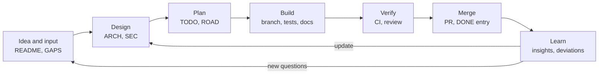

# Development process

How work moves from an idea to merged, documented, tested code in this repository. It applies to
people and coding agents alike, and to every project in it: [ush](../ush/README.md),
[ushgo](../ushgo/README.md) and [wish](../wish/README.md). [CLAUDE.md](../CLAUDE.md) holds the
rules that override everything else (human merges, security, release gate); this document describes
the documents and the workflow. The regime follows `../propeller/docs/SDLC.md`. Status:
2026-10-28 09:59.

## The lifecycle



## Documents

Each project keeps the same set of documents in its `docs/` folder. A project creates only the ones
it needs; this file is the shared default for all of them.

| Document | What it holds |
| --- | --- |
| `README.md` (project root) | What it is, how to install and use it, a map of the documents |
| `docs/ARCH.md` | Architecture: components, flows, decisions and their reasons |
| `docs/SEC.md` | Threat model: assets, trust boundaries, threats, controls, residual risks |
| `docs/TODO.md` | The plan: numbered milestones, tasks and subtasks with checkboxes |
| `docs/ROAD.md` | Phases with goals and gates, and ideas not yet scheduled |
| `docs/GAPS.md` | Questions only the user can answer, and assumptions to check |
| `docs/DONE.md` | Progress log, newest first |

Projects may add more: wish has `IDEA.md` and `SOTA.md`, ush has `SECTEST.md` (its security test
plan). Task and question numbers belong to one project, so references across projects name it:
"ush TODO 2.9", "wish GAPS Q2".

## Work items

- **TODO.md is the plan.** Numbered milestones (`## 1.`), tasks (`1.1`) and subtasks (`1.1.1`),
  each with a checkbox, `[ ]` open or `[x]` done. New work gets new numbers; existing numbers never
  change, and items are never renumbered when they move.
- **Tags:** *(decision)* marks a choice to settle before dependent work starts; *(variant)* an
  alternative built next to the main design for comparison; *(skipped)* an item the user set aside,
  with the date; it stays as a record and doesn't block its milestone.
- **Acceptance.** A task names what must be true for it to count as done. An item stays open while
  its acceptance criteria, tests or documentation are incomplete; scaffolding or a working happy
  path alone doesn't tick it.
- **ROAD.md is the roadmap.** Phases with goals and gates, plus ideas not scheduled. A phase becomes
  TODO milestones when it starts, and ROAD links to them.
- **GAPS.md holds what only the user can decide.** When work reaches such a point, add a numbered
  question (`Q1`), marked **blocking** if it stops a milestone, with a proposed answer where there is
  one. Add an assumption (`A1`) when the documents rely on something unconfirmed. Never act on a
  blocking question's proposed answer without the user's reply.
  - Answers carry date, time and author: `**Answer** (2026-10-27 14:52, Gregor Heinrich): …`.
  - If an answer changes, the new one goes on top; the earlier ones stay below it, struck through,
    each with its own date, time and author.
  - Once answered, the decision moves into the affected document, and the entry gets a line
    `**Resolved** (date time, by whom): where the decision went`. Resolved entries stay.

**Ready to start** means: the item is in TODO.md, no blocking GAPS question stands in its way, and
ARCH and SEC describe what to build.

## DONE entries

DONE.md is the log of completed work, **newest first**. Each entry goes on top and is never
rewritten afterwards; corrections and later outcomes (a merge, a release) become new entries.

```text
## YYYY-MM-DD HH:MM — Title

TODO items: 2.9, 2.10. PR: #7 (stacked on #6).

Agent: Opus 5.5, reasoning: Medium, subagents: none.

### Implementation notes
### Deviations
### Insights
```

- **Time:** local time to the minute, taken from `date`, never estimated.
- **Agent line:** model, reasoning level and subagents; `Agent: human` for human work. A parameter
  the agent can't see is written as `not exposed`, not guessed.
- **Implementation notes:** what was built and where, and the exact validation commands with their
  results. A check that was skipped or couldn't run is named as such.
- **Deviations:** what differs from the plan, and why. **Insights:** what matters for later work.

Entries before 2026-10-27 used an older, oldest-first format. They stay unchanged at the end of each
DONE file, below a marker.

## Branches, commits and pull requests

- `main` changes only through pull requests, which a human reviews and merges. **AI never merges**,
  never approves its own PRs and never enables auto-merge ([CLAUDE.md](../CLAUDE.md)).
- Branches are named `feat/…`, `fix/…`, `chore/…` or `docs/…`, with the project and TODO item where
  it helps: `feat/ush-2.9-terminal-escapes`. One TODO item per branch where practical.
- **Stacked PRs** are fine when work depends on an unmerged PR: base the new PR on the earlier
  branch and say so in its description. Merge from the bottom of the stack up and delete each
  branch when its PR is merged, so GitHub retargets the next PR to `main`.
- **Commits** are logical steps with imperative subjects of up to about 72 characters, a body that
  says what and why, and a `Refs:` trailer naming the TODO items or GAPS entries they serve
  (`Refs: ush TODO 2.9, ush GAPS Q2`). Agent commits end with their attribution line, in the same
  final paragraph as `Refs:` so Git reads both as trailers.
- **PR descriptions** follow [the PR template](../.github/pull_request_template.md): the problem and
  the resulting behaviour, the TODO items, tests and their results, deviations, security impact
  against the project's SEC, remaining limitations, and the base branch of a stacked PR.

## CI

[ci.yml](../.github/workflows/ci.yml) defines CI. While GitHub Actions doesn't start jobs for this
account, `just ci` runs it on a clean worktree of a commit and `just ci --post` reports the result
to the PR as commit statuses; see [tools/ci/README.md](../tools/ci/README.md). Push first, then
`just ci --post`, after every push.

## Definition of done

A TODO item is done when, in the same PR:

1. **It works** as ARCH describes, or the deviation is recorded.
2. **Tests** cover its externally observable behaviour and its relevant errors: cancellation,
   conflicts, limits and denied permissions where they apply. A bug fix comes with a regression test
   that fails on the old code.
3. **CI passes:** `just ci --post` on the PR's head commit, while Actions is unavailable.
4. **Docs are current:** README, ARCH, SEC, ROAD and GAPS as affected; `just links` passes and
   `just pdfs` builds.
5. **Security impact** is stated against the project's SEC, even if it's "none". Changes to grants,
   storage, isolation, egress, credentials or authorization come with a threat-model update and
   negative tests.
6. **TODO.md** has the item ticked and **DONE.md** has an entry on top.

## TODO mode

When the user sends "TODO mode: …", the agent works through the remaining milestones of the named
project in TODO order:

1. **Pick the next actionable item.** Items only the user can do (manual checks, answers) stay open
   and are listed in the PR; they don't block the rest.
2. **One branch and one PR per milestone,** each branch starting from the previous one and each PR
   naming its base.
3. **Done per milestone:** the definition of done above, for every item in it.
4. **Decide what the documents allow:** a *(decision)* with a proposal in the documents and no open
   GAPS question is settled by the agent and recorded in DONE with its reasoning. Anything else
   becomes a GAPS question.
5. **Stop** at a blocking GAPS question, a decision the documents don't settle, a failing gate or
   missing access: record the blocker in GAPS, DONE and the PR, and ask.
6. **Report** after each milestone: what was done and decided, what's blocked, the PR link.

## Decisions

- Small decisions: in the PR and its DONE entry.
- Decisions that change architecture, security or dependencies: in ARCH or SEC with a dated status
  line, plus the DONE entry.
- Decisions only the user can make: through GAPS.

## ush: one command, two implementations

`ush` is one command with two implementations that must behave the same (decided 2026-10-28,
[ushgo GAPS](../ushgo/docs/GAPS.md) Q2):

| | Python, [ush/](../ush/README.md) | Go, [ushgo/](../ushgo/README.md) |
| --- | --- | --- |
| Role | Experimental: features are designed and tried here first | The compiled deliverable: what users install |
| Tests | `just ush-test` (unittest; fake providers, mock API, pty) | `just ushgo-test` (gofmt, vet, `go test`) |
| `ush --version` | `ush X.Y.Z (python)` | `ush X.Y.Z (go)` |

**How a feature moves:**

1. **Design** in ush's ARCH and SEC, with a ush TODO item.
2. **Build and test it in Python**, with negative tests for anything that touches the policy,
   execution, credentials or egress. Behaviour that users see is specified by tests that drive the
   command from outside (CLI, pty, mock API), because those tests also run against Go.
3. **In the same PR, add the ushgo TODO item** that ports it, naming the Python tests that define
   it. A feature is in ush's DONE when Python has it; it reaches users when ushgo has it.
4. **Port it to Go** in a separate PR, with the Python tests ported or run as conformance tests
   against the Go binary (ushgo TODO 1.10). A difference in behaviour is a bug in one of the two
   unless ARCH records it.
5. **Smoke-test both** as a user, with the same script ([SMOKE](../ush/docs/SMOKE.md)):
   `ush/scripts/smoke.sh --bin <either ush>`.

**Shared contract:** settings (`~/.config/ush/config.json`), key store, history format, exit
statuses, environment variables (`USH_*`) and the zsh plugin are the same for both; a change to any
of them is made in both, or in Python with the ushgo item that follows.

**Security-relevant code first in both:** fixes for findings in [SECTEST](../ush/docs/SECTEST.md)
go into Python and get their ushgo item in the same PR; the ushgo port of the policy (TODO 1.1)
starts from the fixed version.

**Releases:** a ush release ships the Go binary once ushgo passes the conformance suite (ushgo
ROAD); until then, the Python implementation. Either way, the release gate in
[CLAUDE.md](../CLAUDE.md) and the smoke test run on what ships.

## Releases

The release gate in [CLAUDE.md](../CLAUDE.md) applies to every release, previews and patches
included: fresh checks on the exact candidate, the adversarial security tests, scans, and a release
PR that a human reviews, merges and publishes.
