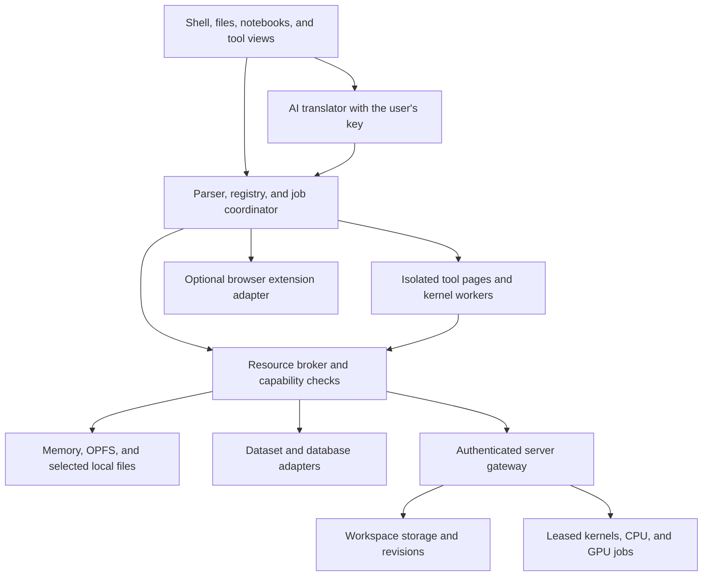

# wish technical architecture

Status: proposed architecture, 2026-10-13. Commands and APIs are illustrative.
The product definition is in [IDEA.md](IDEA.md), security requirements in
[SEC.md](SEC.md), and implementation precedents in [SOTA.md](SOTA.md).

wish makes the browser a place to create files, manage data, run notebooks, and
build interactive tools. Its primary abstraction is a **workspace with mounted
resources**. DOM interaction is one workspace interface; browser automation is an
optional adapter. A workspace can operate entirely on the client or explicitly
attach authenticated server storage and compute.

## Components and deployment

Use TypeScript for the browser core and adapter contracts. Keep the core independent
of a particular notebook UI, AI provider, database, or server implementation.
The shell, notebook editor, file manager, and page views consume the same workspace
services and event stream.

Deploy the trusted shell at an HTTPS application origin, for example
`app.wish.example`. It owns storage metadata, user authentication, permission
decisions, and the AI transport. Execute user code in a separate runtime site,
for example `w-<id>.wish-runtime.example`, with an origin per isolation domain.
That site receives no application session cookies or AI key. A sandboxed tool
frame creates its workers there; workers provide scheduling and cancellation,
while the origin separation provides the important authority boundary.

The runtime bootloader establishes a versioned `MessageChannel` after checking
the expected frame and origin. The trusted broker binds the port to a workspace,
runtime identity, and grants. Requests cannot choose their own identity or acquire
authority by naming another workspace. File handles and backend credentials stay
with the broker; runtime code receives only scoped RPC interfaces.

An optional service worker caches the application and pinned runtime assets for
offline use. It is not the owner of long-running kernels. A document coordinator
owns jobs, with a storage adapter coordinating writers across open tabs. Server
jobs have their own lifecycle and may reconnect after the page closes.

## Workspace and command model

A workspace stores an ID, current directory, mount table, named datasets, resource
leases, tool definitions, notebook files, and command history. Persist declarations
and artifacts; interpreter globals and running workers remain transient.

Every command registry entry declares its name, argument schema, input/output
types, runtime handler, required capabilities, and conservative effect description.
The parser produces a finite command AST. Typed commands and AI-generated commands
use the same validator and executor. Executable Python or JavaScript supplied as
an argument or file always goes to an isolated runtime; parsing a shell command
does not establish that its program is harmless.

Each job captures `workspaceId`, command AST, selected resources and revisions,
grants, runtime ID, deadline, and output limits. Its states are `queued`, `running`,
`waiting-for-input`, `completed`, `failed`, and `cancelled`. Grants are checked at
dispatch and on every broker operation. Navigation invalidates page handles;
file revisions and lease expiry determine whether other work remains valid.

Use asynchronous streams for text, JSON records, byte chunks, and resource handles.
Declare conversions explicitly. Streams have backpressure and bounded buffers;
large results travel as artifact references instead of accumulating in the prompt.
Diagnostics and MIME display results are separate from pipeline data.

## Files and persistence

| Mount | Backend | Persistence and behavior |
| --- | --- | --- |
| `/` | Workspace files in OPFS, with IndexedDB metadata | Survives normal reloads; subject to browser storage lifecycle |
| `/tmp` | Memory | Discarded when the session ends |
| `/local/<name>` | User-selected directory handle | Writes selected physical files where the browser supports the API |
| `/remote/<name>` | Authenticated workspace/object-storage adapter | Server persistence, access checks, and versioned writes |

If durable browser storage is unavailable, offer an explicit memory workspace with
import/export. Report the selected storage mode and dirty state. Browser persistence
does not equal a backup; show export and optional server synchronization separately.
OPFS is private to an origin and supports efficient worker file access, but clearing
site data removes it. See [MDN's OPFS documentation](https://developer.mozilla.org/en-US/docs/Web/API/File_System_API/Origin_private_file_system).

The VFS adapter contract includes `stat`, `list`, `read`, `write`, `mkdir`, `remove`,
and change events. Adapters declare supported operations, quotas, and consistency
semantics. Normalize paths before grant checks, reject traversal outside a mount,
and treat cross-mount moves as copy followed by explicitly acknowledged deletion.

Use revision-conditional writes. Stage file output and publish it only after its
producing command succeeds where the backend supports replacement. A browser
storage adapter needs a journal or immutable blobs with a committed metadata pointer;
OPFS and IndexedDB do not form one automatic transaction. Serialize conflicting
writers. Keep interrupted writes recoverable, and make offline remote conflicts
visible rather than silently choosing a winner. External effects are not rolled
back merely because another command fails.

## Data and virtual resources

Datasets have a name, schema, storage reference, revision, and permitted operations.
`data import` registers or converts a workspace file; `data append` performs a
schema-checked update. Start with files and records, then add a worker database
adapter when queries and transactional updates justify it. DuckDB-Wasm is a
candidate for analytics, while SQLite Wasm or PGlite suit mutable application data;
their tradeoffs are recorded in [SOTA.md](SOTA.md).

Represent a resource as an opaque handle with a type, owner/workspace, location,
operations, limits, and expiry. The broker implements `list`, `acquire`, `invoke`,
and `release`. Programs use the same logical interface while placement remains
visible to the user.

| Resource | Browser implementation | Server implementation |
| --- | --- | --- |
| File volume | Memory or brokered OPFS subtree | Authorized storage prefix or allocated volume |
| Compute session | JavaScript/Wasm/Python worker | Isolated, leased process or kernel |
| GPU computation | Feature-detected WebGPU adapter | Allocated GPU job with a service-specific interface |
| Device stream | Simulation or explicitly granted hardware adapter | Authorized sensor/device service |

These interfaces virtualize access to physical resources; they do not promise a
full operating system or identical APIs everywhere. A browser worker cannot offer
a guaranteed physical CPU reservation. Local limits include broker quotas,
Wasm memory bounds where supported, and deadlines; hard process/GPU accounting
belongs to the server runtime. Release ports and buffers on cancellation, and
expire remote leases even if a tab disappears without sending a cleanup event.

## Kernels, notebooks, and live tools

The first Python kernel should use Pyodide in a worker on the isolated runtime site.
Provide a kernel interface for `start`, `execute`, `interrupt`, `restart`, and
`dispose`, with input requests, stdout/stderr, errors, and MIME display events.
Pyodide documents worker execution and its virtual filesystem; see
[workers](https://pyodide.org/en/stable/usage/webworker.html) and
[filesystem access](https://pyodide.org/en/stable/usage/file-system.html).

For the first file bridge, materialize the cell's granted input files in the kernel
filesystem, record their revisions, and stage modified files/deletions after the
cell finishes. Commit only authorized changes against those revisions. This avoids
assuming that asynchronous browser RPC behaves like synchronous Python file I/O.
Large files and interactive writes can later use a dedicated synchronous filesystem
adapter. JupyterLite already addresses this integration using shared-memory or
service-worker bridges; see its [kernel filesystem documentation](https://jupyterlite.readthedocs.io/en/stable/howto/content/python.html).

Store notebooks as `.ipynb` documents with stable cell IDs, source, outputs, and
execution metadata. Record input revisions, package/runtime versions, and runtime
placement for each execution. Notebook state and saved file state are distinct:
restarting a kernel loses interpreter variables without deleting its notebook.
Make rerun order explicit; automatic reactive execution must respect the same
side-effect and resource rules as a manual command.

Render plain text and supported rich MIME outputs in trusted renderers. Sanitize
HTML, and put executable widgets or user-authored pages in isolated tool frames.
Tool manifests declare their entry point, parameters, provided commands, and
requested resources. A tool may render a plot, dataset editor, or notebook while
the shell continues to operate on its declared files and data. Updates travel over
the bridge; arbitrary application state is not inferred from its DOM.

For Wasm, support typed export calls and a documented command ABI for streams,
arguments, diagnostics, exit status, and broker imports. WASI/component adapters
are extensions to that ABI, not assumptions about every `.wasm` file. JavaScript
command modules run under the same runtime grants. Package loading uses pinned
artifacts and a compatible package manifest; incompatible native Python dependencies
return an actionable error rather than automatically switching to server execution.

## Optional server storage and compute

Storage and compute are independent features. A user may save files on a server
while running every cell locally, or explicitly allocate remote compute for an
otherwise local workspace. Configure the server in trusted settings and identify
which resource location each command uses.

The gateway authenticates users, authorizes workspace membership and operations,
and maps logical resource IDs to storage prefixes or runtime allocations. A minimal
API covers file reads/conditional writes, dataset operations, lease creation,
job submission, streamed events, cancellation, and lease release. Include request
IDs and receipts for mutations so reconnects can discover completion without
repeating a potentially completed action.

Remote Python can use a Jupyter-compatible kernel adapter behind the gateway;
Jupyter Server already defines [contents, sessions, and kernel APIs](https://jupyter-server.readthedocs.io/en/latest/developers/rest-api.html).
Give each untrusted session isolated execution, bounded storage/CPU/memory,
controlled egress, and no inherited infrastructure credentials. The browser never
receives a host shell or a kernel administrator token. Connection loss produces
an explicit detached/unknown state until the gateway reports the job's outcome.

## AI translation and credentials

An input line beginning with `//` requests a bounded program in the wish language.
The translator receives command schemas, named resources, selected revisions, and
only user-approved context. Provider-specific adapters return a structured result
containing commands; the core checks grammar, types, grants, size, and step count.
Display and record the generated program, then execute it automatically within
existing grants. A preview mode is optional. Runtime code cannot initiate AI requests
or change provider configuration.

Keep the user's key in the trusted AI transport's session memory. Direct provider
calls require a browser-compatible endpoint; otherwise use an explicitly configured
user-controlled broker or credential service. That service becomes an additional
trusted party. No key appears in VFS mounts, notebook outputs, runtime messages,
history, or prompts. AI context disclosure and file/runtime access are separate
grants. See [SEC.md](SEC.md) for the limits of credential isolation and redaction.

## Implementation sequence and acceptance

1. Deliver the parser, registry, memory VFS, jobs, and file editor. Prove file creation,
   pipelines, cancellation, and visible errors without AI or a backend.
2. Add browser persistence and an isolated Pyodide notebook. Import a CSV, execute a
   plotting cell, save its artifacts, reload the workspace, and restart its kernel.
3. Add live tool frames, typed data handles, and Wasm commands. Verify that a tool
   and notebook see committed updates through the same broker.
4. Add one AI adapter: `// create a Python notebook named analysis` generates and
   executes `notebook create /notebooks/analysis.ipynb --kernel python` with the user's key.
5. Add authenticated remote storage, then leased compute. Exercise conditional-write
   conflicts, disconnect/reconnect, cancellation, lease expiry, and authorization.
6. Add optional external-tab and hardware adapters once the workspace is useful.

Open decisions before implementation: notebook UI reuse versus a smaller editor;
the initial Wasm ABI; runtime packaging and isolation headers; storage migration
and backup format; server kernel isolation; and supported browsers. Evaluate these
against the concrete notebook workflow rather than expanding the shell grammar first.
