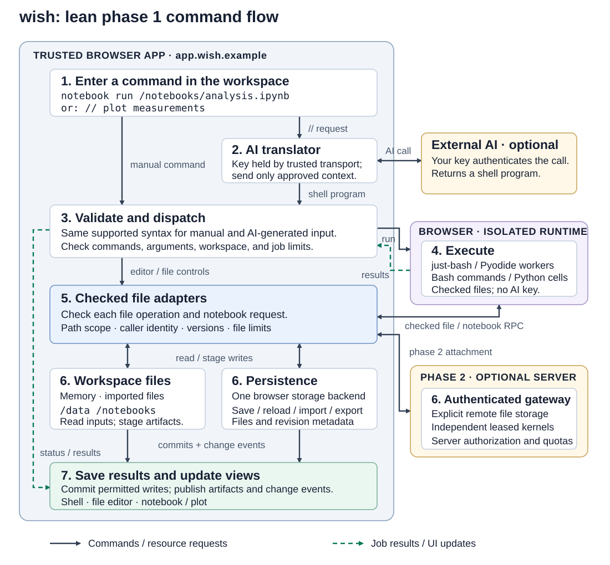

# wish architecture

Status: architecture for the site workspace, 2026-11-10, with the decisions on GAPS Q5–Q11 of 10:38; nothing is implemented. The
product is in [IDEA](IDEA.md), the phases in [ROAD](ROAD.md), security in [SEC](SEC.md), prior
art in [SOTA](SOTA.md), open decisions in [GAPS](GAPS.md). The architecture of the browser
workspace (2026-10-14), which remains the substrate for the shell, files, notebook and `//`, is
kept unchanged in the [last section](#workspace-substrate-architecture-2026-10-14).

wish is a local program. A trusted host process drives a browser through Playwright, presents a
shell whose filesystem includes a site's pages, links and overlay, and writes captures and the
overlay as open-format files into a workspace directory. Everything it needs is open source;
it depends on no Lakeshore component (decision by the user, 2026-11-10).

## Decisions

| Date | Decision | Reason |
| --- | --- | --- |
| 2026-11-10 | wish's working space is a website: its pages, their semantic structure, and its links ([IDEA](IDEA.md)) | The user's adjustment of the idea; the earlier workspace becomes the substrate |
| 2026-11-10 | Playwright is the capture framework | The user's choice. It renders pages as a real browser (Chromium, Firefox, WebKit), keeps logged-in sessions in persistent contexts, exposes accessibility snapshots and network events; Apache-2.0, maintained by Microsoft ([SOTA](SOTA.md#crawling-capture-and-semantic-extraction)) |
| 2026-11-10 | The host is a local process (TypeScript on Node.js), not a browser-only application (GAPS Q6); its own program `wish`, separate from ush, sharing the `//` request contract (Q11) | Playwright drives browsers from a process; a web page can't. TypeScript keeps one language with just-bash and Playwright's primary API. This replaces assumption A1 ("no server, all data in the browser") for the site workspace; the browser-only design stays valid for the substrate |
| 2026-11-10 | No dependency on Lakeshore; interoperability only through wish's own open export format | wish is open source (MIT); key Lakeshore components may be closed. A consumer imports wish's export on its side |
| 2026-11-10 | The overlay is files (JSON Lines) plus a rebuildable SQLite index (GAPS Q8) | Open, greppable, diffable data that shell tools and other programs can read; the index can always be dropped and rebuilt |
| 2026-11-10 | Crawling works with the user's own access only; the robots policy is configurable per site profile (GAPS Q7) | The user decides per site; the default honours robots rules for unauthenticated crawls and shows them for logged-in ones, and every run records the setting |
| 2026-11-10 | The AI provider is configurable per site profile, Ollama locally included; masking and synonymization are configurable; local models of 13B–30B are the design target (GAPS Q9) | Private site content can stay on the machine; model tasks are sized so that such models handle them |
| 2026-11-10 | Evidence and trends are researched on additional sites; messages are integrated outside wish (GAPS Q10) | wish stays a site tool; a claim or topic comes in as an argument or on stdin |

## Components

```text
 terminal ── shell (just-bash) ── command set: site, crawl, capture, links, explain, ask, evidence, trend, //
                │
                ├─ filesystem adapter ── workspace dir (checked read/write)
                │                    └── virtual, read-only: /site  /sem  /cap  @links  page tree
                │
 trusted host ──┼─ policy: scope, budgets, navigation safety, AI disclosure grants
                ├─ crawl loop: frontier → planner (rule or model) → policy → capture
                ├─ capture engine ── Playwright ── browser (headed for login; per-site profile)
                ├─ extraction: templates, rules, model proposals → statements with anchors
                ├─ overlay store: JSON Lines files + SQLite index (FTS)
                ├─ retrieval and explanation
                └─ AI transport (provider per profile; masking, synonymization), session store
```

The **host** is trusted: it owns policy, the AI key, the browser sessions and the workspace.
The **browser** renders untrusted sites; its profile holds the site's cookies. The **shell**
runs commands the user typed or `//` generated, with the same validation for both. Page
content, claim text and model output are data, never instructions to the host.

## Host and browser

- One **persistent Playwright context per site profile**, stored under wish's state directory
  (`~/.local/state/wish/profiles/<profile>`, mode 0700), never inside the workspace. `site open
  URL --login` opens it headed; the user logs in in that window, and wish keeps the context.
  wish never asks for, sees or stores the password; the profile's cookies and storage are a
  credential and are treated as one ([SEC](SEC.md#site-capture-and-crawling)).
- Attaching to the user's everyday browser over CDP (`connectOverCDP`) is not the default: it
  would hand wish every session in that profile. It may come later as an explicit option.
- Headless crawling reuses the profile after login. Concurrency per logged-in site is 1 by
  default, with a rate limit; unauthenticated crawls may use more.
- Pinned browser builds through Playwright's installer, recorded per capture
  (Playwright version, browser and version, viewport, locale, user agent).

## Capture engine

For each page, after load and a settle condition (network idle or a bounded wait):

| Field | Source |
| --- | --- |
| `url`, `final_url`, `status`, `redirects` | navigation response chain |
| `captured_at`, `run`, `profile`, `browser` | host |
| `tree` | `locator('body').ariaSnapshot()` joined with DOM facts the accessibility tree lacks (element IDs, table cells, `href`s, microdata/JSON-LD) |
| `links` | every `a[href]` and `area[href]` with role context (landmark, list, table), anchor text, accessible name, resolved target, `rel` |
| `digest` | SHA-256 of the canonicalised tree text, and of the main content |
| `content` (`--data`) | selected passages, tables and values with anchors |
| `warc` (`--mirror`) | request/response records of everything fetched |

Mirror capture records responses as they arrive (Playwright response events or a recording
proxy) and writes WARC 1.1 files; how faithfully each approach keeps headers and bodies is
decided in TODO 11.2. A browsable file tree (`mirror/<host>/<path>`) is generated from the WARC,
not captured separately.

Captures are append-only. A recapture of the same URL is a new snapshot; diffs compare
snapshots.

## Namespaces as a filesystem

The shell's filesystem adapter mounts read-only virtual trees beside the checked workspace
directory:

| Path | Backed by | Listing |
| --- | --- | --- |
| page tree (cwd inside a page) | the page's latest snapshot or the live page | semantic nodes: `role:Accessible name`, indexed where repeated |
| `/site/<host>/<url-path>` | captured URLs, plus live pages | pages as directories; query strings as `?k=v` entries |
| `@links` (inside a page) | the snapshot's links | one entry per link: role, text, target, state |
| `/sem/<type>/<entity>` | the overlay index | entities; inside, statements and their sources |
| `/cap/<run>` | capture runs | `run.json`, `pages.jsonl`, `decisions.jsonl`, `warc/`, `mirror/` |

`cat` of a node prints its text (tables as CSV); `cat -l` adds the anchor. `ls -l` shows type,
state (live or captured, and when), and size. Writes to virtual trees fail. Paths are stable
across recaptures while the structure is unchanged; otherwise the old path resolves to its
snapshot and reports the node as moved or missing in the new one, by matching role, name and
text digest.

just-bash is the first candidate for the shell, as in the substrate ([SOTA](SOTA.md)): its
custom-filesystem and custom-command interfaces are what this needs, and it runs on Node. The
spike (TODO 2.1) now also checks that a virtual filesystem can be mounted next to a directory on
disk with checked access.

## Crawl loop

```text
seed ─► frontier ─► planner ─► policy ─► capture ─► extract ─► links into frontier
           ▲          (rule | model)  (admit/refuse)                     │
           └──────────────────────── decision record ◄──────────────────┘
```

- **Frontier:** candidate links with features (role, anchor text, context, target pattern,
  template of known pages behind similar links, depth, duplicates).
- **Planner:** a rule (breadth first, depth-limited) or a model call that ranks a bounded batch
  of candidates by their IDs against the goal and labels the relation. The model sees link
  features and short excerpts the disclosure grant permits; it returns IDs and labels, never URLs
  or commands.
- **Policy:** scope (origins, path prefixes), budget (pages, time, model calls, cost), rate,
  the robots policy of the site profile (`honour` or `show`; default `honour` without login,
  `show` with login; recorded per run), navigation safety, deduplication (canonical URL, digest). It is
  deterministic and its outcome doesn't depend on model output except through the ranking.
- **Decision record** (`decisions.jsonl`): link, outcome (followed, skipped, refused), reason
  codes, planner inputs digest, model and prompt version or rule, policy rule that applied.
- **Stop:** goal met (planner says so and the policy agrees), budget exhausted, frontier
  empty, or cancelled; recorded with the unreached frontier.

## Extraction and the overlay

Templates are clusters of pages with the same structural signature (tree shape without text).
A new template gets an **extraction schema**: semantic paths to fields, proposed by the model
from one exemplar, checked against a second (paths resolve, types parse), then applied
deterministically. Rules cover what needs no model: headings to topics, tables and definition
lists to attributes, lists to members, breadcrumbs to categories, JSON-LD/microdata to typed
entities.

The overlay format is wish's own and versioned (`wish-overlay/1`):

```json
{"id": "st:01JCX…", "subject": "ent:project/atlas", "predicate": "owner",
 "object": {"entity": "ent:person/r-diaz"},
 "anchors": [{"page": "pg:3f9a…", "url": "https://wiki.example.org/projects/atlas",
   "captured_at": "2026-11-10T09:12:44Z",
   "selectors": [{"type": "SemanticPath", "value": "main/section:Owners/table:Owners/row:3"},
                 {"type": "CssSelector", "value": "#owners tr:nth-child(3)"},
                 {"type": "TextQuoteSelector", "exact": "R. Diaz"}]}],
 "method": {"kind": "template", "template": "tpl:7c1…", "version": 2},
 "run": "run:01JCX…", "mode": "data", "review": "proposed"}
```

- `--refs` keeps entities, types, relations and page roles, with a `TextQuoteDigest` in place of
  `TextQuoteSelector`; attribute values and passages need `--data`.
- Entities get IDs from type and normalised name per site. **Identity across sites** is a
  separate, proposed `same_as` statement with its evidence, never a silent merge.
- Statements are never edited; a correction is a new statement that supersedes an old one.
- Files: `overlay/statements.jsonl`, `overlay/entities.jsonl`, plus `captures/…`. The SQLite
  index (FTS5 for text, tables for the graph) is derived and rebuildable from the files.

## Retrieval and explanation

`ask` and `//` questions select statements through the graph (entities named or found by
full-text search, their neighbourhood, page types), then passages by anchor, each with its
heading path as context. The model answers only from the selected items and cites their IDs;
wish checks every citation resolves and that each cited item was in the selection. An answer
without enough support says so.

`explain ID` walks the records: statement → anchors and capture → extraction method and its
checks → crawl decisions from the seed to the page → coverage of the run (in-scope pages not
captured, refused links, budget stop, capture age). Embedding-based retrieval is a later option
evaluated against this baseline (TODO 13.1), not a prerequisite.

## Evidence and trends from additional sites

`evidence` and `trend` take a claim or topic as an argument or on stdin; wish reads no mailboxes
or feeds, and message integration is an external tool's job (GAPS Q10).

- **Match:** claims and entities are extracted from the text (model proposals, checked against
  the overlay's entities) and matched to statements: supporting, contradicting (same subject and
  predicate, different object) or unknown.
- **Research:** candidate sites come from a configured source list for the topic and from
  off-site links in existing captures. The model may rank them; the policy admits a site only if
  it is on the allowlist or the user confirms it (GAPS Q12), and refuses loopback, private-network
  and link-local addresses. Each admitted site gets an unauthenticated agentic crawl with the
  claim as goal and its own scope and budget.
- **Trends:** snapshots of the same pages over time give changes; statements across sites give
  spread. Statements whose text or source chain leads to one origin (copies, syndication) count
  once.
- **Report:** a file with citations into the overlay, disagreements with both sides, and the
  coverage (sites and pages searched, refused, unreached).

## AI

The substrate's provider adapter and key handling apply ([WORKSPACE](WORKSPACE.md), substrate
section below), extended for the site workspace (GAPS Q9):

- **Provider per site profile:** a remote API with the user's key, or a local model through
  Ollama on loopback, with a default for sites without a profile. A remote provider also needs a
  **disclosure grant** for that site, separate from the permission to capture it; a local
  provider keeps content on the machine and needs none.
- **Model size target:** local models of 13B to 30B parameters. Every model task is designed for
  them: link ranking over a bounded batch of candidate IDs, schema proposal from one exemplar,
  extraction checked against the page, answers over a bounded set of cited items. Structured
  output is validated; on failure the step falls back to rules. Evaluations (TODO 11.3, 11.4,
  13.1) report results with a remote model and with a local model in that range.
- **Privacy step before every model call,** configurable per profile and provider:
  - *data masking* replaces configured patterns and field types (e-mail addresses, phone and
    account numbers, IDs, password fields, token-like strings) with typed placeholders
    (`[EMAIL_1]`) that aren't reversed;
  - *synonymization* replaces names and identifiers (people, organisations, projects, and terms
    the profile lists) with consistent stand-ins (`Person A`, `Org B`) and reverses them in the
    response. The mapping stays in the host's memory for the call, never in requests, logs or
    exports.
  - The run log records, per call, provider, model, the privacy settings and a digest of what
    was sent.

## Export and interoperability

The workspace is the export: `captures/` (WARC 1.1, `pages.jsonl`, `decisions.jsonl`) and
`overlay/` (`wish-overlay/1`), with JSON Schemas published in wish's repository and a version
in every file header. Selectors follow the W3C Web Annotation model so other tools can resolve
them. Profiles, keys and the SQLite index are never exported.

Any consumer, Lakeshore among them, reads this format with its own importer. wish publishes the
format and tests it against its schemas; it has no consumer-specific code and imports no
consumer's schemas or libraries.

## Testing

A local fixture-site server (TODO 10.2) serves sites with login, templates, pagination, infinite
calendars, logout and delete links, state-changing GET endpoints that record whether they were
hit, cross-site links, injected instructions, and changes between two "days". Tests run
Playwright against it and a mock AI provider; no test contacts a real site or a paid provider.

## Workspace substrate architecture (2026-10-14)

The architecture of the browser workspace, unchanged below. It applies to the shell, checked
files, notebook and `//` where the site workspace uses them, and fully if wish gets a
browser-hosted variant (GAPS Q6). Its "phase 1" is the substrate track in [ROAD](ROAD.md).

Status: proposed phase 1 architecture, 2026-10-14; runtime features are not
implemented. [ROAD.md](ROAD.md) defines the lean starting scope and conditional
phase 2 ideas. Product behavior is in [IDEA.md](IDEA.md), security boundaries in
[SEC.md](SEC.md), and component research in [SOTA.md](SOTA.md).

Phase 1 is a browser shell over workspace files with one Python notebook and
optional natural-language translation. Reuse just-bash if its integration spike
passes. Compose through byte/text pipes and JSON/CSV files. TypeScript interfaces
and internal job/kernel IDs help implement the system; they do not create typed
shell streams or a public resource-handle language.

### How a phase 1 command runs



1. **Input:** the user submits a shell program or a standalone `//` request.
2. **Optional translation:** the trusted AI transport uses the user's key and only
   approved context to return a shell program. Ordinary commands work without AI.
3. **Validation:** check the supported syntax, permitted commands/arguments, input
   bounds, and selected workspace before execution. Both input paths use this policy.
4. **Execution:** just-bash runs in an isolated worker. A vetted notebook command
   invokes the isolated Pyodide worker; notebook source never executes in the app.
5. **File access:** a checked adapter validates caller identity, path scope,
   read/write permissions, file versions, and size limits. Runtime workers receive
   scoped file snapshots or checked messages, never the AI key or physical file grants.
6. **Storage:** keep bounded session files in memory; one browser storage adapter
   saves files/metadata. Import/export is available even without persistent storage.
7. **Results:** commit successful authorized changes against expected versions and
   update the prompt, file editor, and notebook view. Record output, errors, and
   command history without credentials. Report conflicts and cancelled/failed jobs.

Server storage/compute and additional page/module adapters are phase 2 extensions.
The diagram's server box is outside the phase 1 acceptance path.

### Components and deployment

Use a small TypeScript application, a shell worker adapter, a notebook adapter,
checked file operations, and an AI transport. UI views share the same saved files
and notifications. Avoid a general resource scheduler or plugin framework.

The trusted app owns permissions, saved files/metadata, history, and AI settings.
The execution launcher is served at a separate runtime site, with no app session
cookies or AI key. It hosts the shell/Python workers and any executable notebook
widgets. Origin separation protects the trusted app; workers provide responsiveness
and termination. A worker alone is not the credential/storage boundary.

Bootstrap a dedicated message port after checking the expected frame and origin.
Bind its caller/workspace server-side in the trusted app, validate messages, and
invalidate the binding on reload or disposal. Start with one active workspace and
simple permitted file subtrees/operations; add more elaborate identity/grant models
only when supported workloads need them.

Pin runtime assets and limit destinations required to load them. Keep arbitrary
runtime network access disabled in the initial execution profile. Test the actual
remaining egress channels as described in SEC. SharedArrayBuffer, threading,
service-worker filesystem bridges, and per-workspace origin orchestration are not
prerequisites for the first file-snapshot workflow.

### Shell, commands, and state

just-bash is a candidate dependency, not a security policy or a committed runtime
choice before the spike. Define the tested syntax subset for quoting, arguments,
newlines, pipes, and redirection; register a few commands such as
`notebook create/open/run`, `jobs`, `cancel`, and `ai configure/status/clear-key`.
Validate unsupported constructs and command arguments before starting execution.
Keep policy checks on file/notebook operations at runtime as well.

Use the engine's parser and execution machinery rather than building a second Bash
implementation. Use its parsed representation for validation where the selected
version permits. Do not evaluate generated source as privileged JavaScript, and do
not assume parsing proves the effects of notebook code.

Pipes carry bytes/text; JSON and CSV are explicit formats. Binary input/output,
pipeline failures, output bounds, and redirection must pass the integration tests.
A failed pipeline must report failure and prevent dependent work. Confirm the
engine's pipeline-failure behavior rather than inheriting an unchecked default.

The application records the selected workspace/directory, job ID, source program,
results, and limits. Verify cwd/environment behavior between prompt submissions in
the spike: an engine API call is not automatically a persistent interactive shell
session. Saved files survive kernel/shell restarts; interpreter variables may not.

Jobs initially run through a small queue with output limits, deadlines, and explicit
cancellation. Terminate unresponsive workers, reject late results, and invalidate
their authority. Already completed external effects are not rolled back by a later
failure; never retry an uncertain mutation without checking its outcome.

### Files and persistence

Start with the engine's bounded memory filesystem behind checked adapters. File
paths such as `/data/measurements.csv` and `/notebooks/analysis.ipynb` are workspace
paths, not physical disk authority. Import selected files using browser controls;
export a workspace without credentials or transient runtime state.

Choose one persistence backend. IndexedDB is the initial candidate for small file
blobs and revision metadata committed together. Large-file OPFS access and physical
directory mounts are later options, not mandatory parallel implementations. Show
memory/persistent mode, dirty state, storage failures, and export recovery.

Use expected file versions for commits. Serialize writes or return a conflict
when another writer changed an input/output. Stage job output and publish permitted
changes only after success; cancelled/failed staged writes leave the old files.
Do not describe a complete shell program as an atomic transaction. Test interruption,
quota failures, and restore; browser storage remains subject to clearing/eviction.

Data begins as JSON/CSV files. File versions and change notifications coordinate
shell, editor, and notebook views. Named dataset services, schemas on every shell
value, SQL engines, and a general subscription bus can wait for a demonstrated need.

### Python notebook adapter

Use Pyodide in an isolated worker and one existing notebook UI if its file/kernel
integration fits. Implement start, execute, interrupt, restart, and dispose through
that adapter. Keep `.ipynb` source, cell IDs, saved outputs, and enough execution
metadata to understand a run. A kernel restart loses interpreter variables, not
saved notebook source.

For the first synchronous Python file interface, copy the run's granted inputs into
its filesystem and record their versions. After success, validate and stage changed
files/deletions for the trusted adapter to commit. Reject changes outside the grant
or against stale versions. This avoids introducing a shared-memory filesystem
bridge for the initial small CSV workload.

Render text and supported rich output safely; isolate executable widgets. The
notebook's plot/output view is the first interactive tool. An edit can be observed
through file-change notifications and an explicit notebook rerun. Automatic reactive
execution is deferred until its side effects and permissions are defined.

### Natural language and credentials

Recognize `//` only at the start of a standalone prompt submission, outside quoted
shell text. Send approved context and available command descriptions to one
configured provider. Return a bounded structured response containing shell source;
validate, display, and run it using the ordinary command path. Mixed `//` lines in
larger Bash scripts and new user-language syntax are deferred.

Keep the user's key in trusted session memory. Runtime commands, files, history,
exports, prompts, and notebook outputs do not receive it. Browser-compatible
provider transport or an explicitly configured user-controlled broker is required.
AI context disclosure is a separate permission from file access. Generated programs
cannot change the provider, widen grants, or trigger nested AI calls.

Record the request, displayed program, and actual outcome. Replay uses the program
without another model call. An absent key, invalid response, stale target, exhausted
budget, or ambiguity executes no generated command. Preview is optional; normal
execution proceeds automatically within existing permissions.

### Phase 2 extensions and deferred full-concept ideas

Add adapters individually for live pages, JavaScript/Wasm commands, remote files,
leased kernels, databases, search/recall, external tabs, and selected devices. Use
filenames, byte/text outputs, JSON, and explicit commands as the default interface.
Storage and compute remain independently selected; no automatic server fallback.

Remote storage needs authentication, server-side authorization, conditional writes,
quotas, and receipts. Remote kernels need isolation, bounded leases, controlled
egress, cancellation, and reconnection. A Jupyter-compatible adapter is a candidate;
[Jupyter Server APIs](https://jupyter-server.readthedocs.io/en/latest/developers/rest-api.html)
already cover contents, sessions, and kernels.

A Wasm command adapter must document its argument/byte/file interface; an arbitrary
module is not automatically a shell executable. Component/WASI support can be a
later adapter. External tab access and physical devices require the relevant browser
permissions and tested lifecycle handling.

The original full concept proposed typed record/object pipelines and a uniform
resource-handle API across files, datasets, tools, devices, and compute. These are
optional research directions. Internal types and IDs remain useful, but a new
public protocol needs an acceptance example and migration plan before adoption.
[ROAD.md](ROAD.md) and TODO 8.5 record that decision gate.

### Acceptance

Run the local CSV → shell transform → notebook plot → save/reload workflow, then
verify equivalent `//` execution and replay. Test denial, hostile output, secret
isolation, cancellation, conflict, interruption, and export recovery. Record browser
support and startup/memory measurements. Every selected phase 2 feature extends
these tests; security tests repeat before every release.
